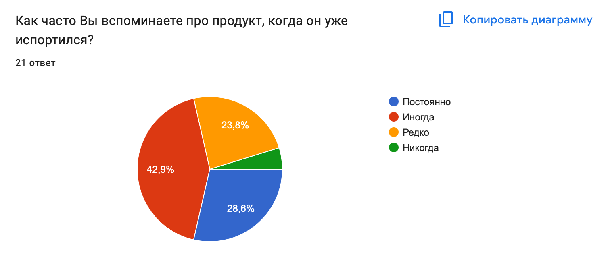
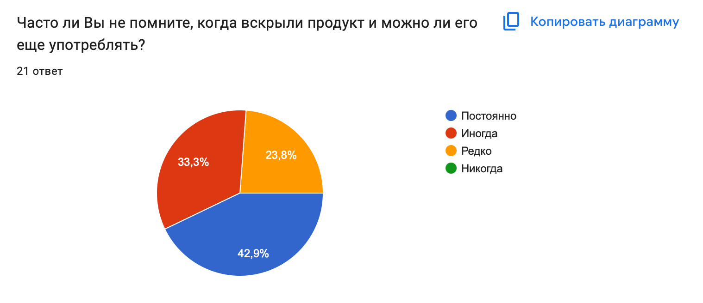

# Евликова Елизавета - "FreshTrack"

### Группа: 10 - И - 5
### Электронная почта: liz.10.evl@gmail.com
### Tg: mr_kfc

**[ НАЗВАНИЕ ПРОЕКТА ]**

“FreshTrack”

**[ ПРОБЛЕМНОЕ ПОЛЕ ]**

Проект относится к области бытового потребления и хранения продуктов питания в домохозяйствах. Акторы: люди, которые пользуются холодильником, готовят, заказывают и покупают еду. Они ориентируются на срок годности и выбирают, что выбрасывать и что готовить.
Люди не могут вспомнить, когда открывали упаковку, и могут не помнить  срок годности. Аналогичные сервисы и приложения могут запомнить и напомнить о сроке годности, однако 1) они не предлагают рецептов под срок 2) у них нет функции, чтобы отследить вскрытие упаковки 3) перевод на русский отсутствует или предлагается некачественный 4) есть платные функции 4) отсутствует статистика по выброшенным продуктам 5) нет возможности импортировать/экспортировать рецепт.

Проблемное поле обосновывается опросом с выборкой в 21 человек. В опросе было примерно 7 вопросов.

**[ ЗАКАЗЧИК / ЦЕЛЕВАЯ АУДИТОРИЯ ]**

Программный продукт ориентирован на широкую аудиторию, потому что рассчитан на решение повседневной проблемы: трудность отследить срок годности продукта. Продукт может заинтересовать:
* Школьников и студентов, которые самостоятельно готовят и хранят еду
* Взрослых, которые ведут хозяйство по дому

**[ АППАРАТНЫЕ / ПРОГРАММНЫЕ ТРЕБОВАНИЯ ]** 
Любое устройство с браузером. Chrome 100+ и FireFox 100+

**[ ФУНКЦИОНАЛЬНЫЕ ТРЕБОВАНИЯ ]**

Программный продукт будет предоставлять следующие возможности:
* Регистрация, вход, редактирование, удаление профиля и смена пароля
* Добавление, редактирование и удаление продукта (название, срок годности, дата вскрытия)
* Сортировка продуктов по сроку
* Список продуктов по категориями
* Уведомление о конце срока годности
* Подбор рецептов
* Добавление своих рецептов
* Статистика выброшенных продуктов
* Экспорт рецептов и статистики

**[ ПОХОЖИЕ / АНАЛОГИЧНЫЕ ПРОДУКТЫ ]**

Анализ 3 программных продуктов, которые максимально приближены к заданному функционалу, показал, что:

* Wonder Fridge: есть реклама и платные функции. Некорректный перевод на русский язык. Отсутствует подборка рецептов и статистика выброшенных продуктов.
*	NoWaste: Food Inventory Lists: Отсутствует перевод на русский язык. Функция напоминания о истечении срока годности отсутствует.
* FridgeWise:  Отсутствует перевод на русский язык. Нельзя добавить дату вскрытия  собственный рецепт.

**[ ИНСТРУМЕНТЫ РАЗРАБОТКИ, ИНФОРМАЦИЯ О БД ]**

*	GitHub, Git
*	HTML, CSS, Bootstrap
* Python, Django
* SQLite - база данных. Она по умолчанию подключена к Django
* VS Code

**[ ЭТАПЫ РАЗРАБОТКИ ]**

*	Разработка пользовательских сценариев
*	Проектирование базы данных
*	Реализация аккаунтов
*	Реализация работы с продуктами
*	Реализация уведомлений
*	Реализация рецептов
*	Реализация статистики
*	Оформлений интерфейса
*	Тестирование, отладка
*	Размещение сервиса в интернете
*	Подготовка проекта к защите

**[ ВОЗМОЖНЫЕ РИСКИ ]**

*	Незнание HTML и Django, в следствие нехватка времени на изучение
*	Трудности с размещением сервиса в интернете
*	Невозможность спроектировать удобный пользовательский интерфейс
*	Потеря данных или кода
